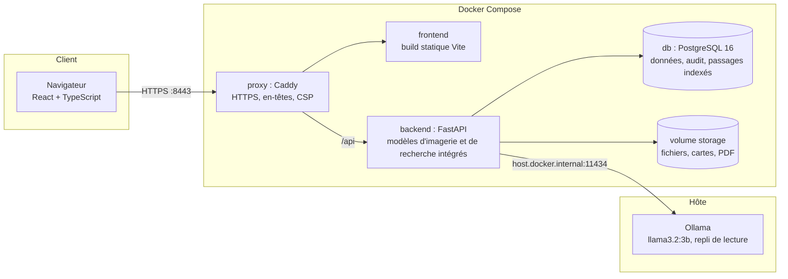
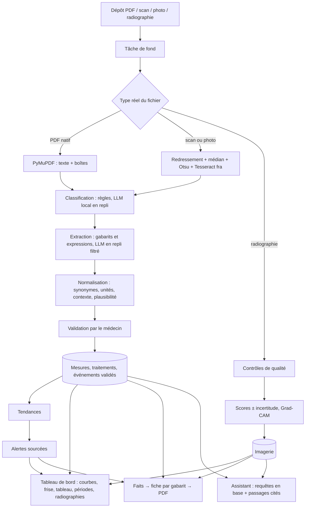

# Architecture

> État livré (v1.0-rc). Détail des choix : `docs/PLAN.md` §7 et `docs/DECISIONS.md`. Diagrammes UML : `docs/uml/` (PlantUML). Dossier de conception complet : `docs/dossier-conception.md`.

## 1. Composants

Seul le proxy publie un port. Les poids TorchXRayVision et le modèle `multilingual-e5-small` sont intégrés à l'image du backend (`HF_HUB_OFFLINE=1`) : aucune donnée ne sort de la machine.

## 2. Découpage du backend

| Couche | Rôle |
|---|---|
| `api/` | Routes REST sous `/api` : `auth`, `users`, `patients`, `documents`, `clinical` (séries, tendances, alertes, frise, faits, périodes), `imaging` (scores, Grad-CAM, annotations, jugement d'évolution, carte de différence), `sheets` (fiche), `assistant`, `system` ; contrôle d'accès par `current_user`, `require_role`, `get_patient_for_doctor` |
| `schemas/` | Modèles Pydantic d'entrée et de sortie |
| `services/ingestion/` | Texte et OCR (`text`), classification (`classify`), extraction (`extract`, `clinical`), normalisation (`normalize`), orchestration (`pipeline`, `job`) |
| `services/trends`, `alerts`, `periods`, `timeline` | Séries validées, Theil-Sen et qualification, moteur de règles du référentiel, comparaison de périodes, frise des traitements |
| `services/imaging`, `registration` | Inférence TorchXRayVision, incertitude, Grad-CAM, contrôles de qualité ; recalage et carte de différence |
| `services/facts`, `sheet`, `assist` | Dossier de faits, fiche par gabarit (Jinja2 → PDF PyMuPDF) ; rédaction assistée et vérificateur (évaluation seulement, T35) |
| `services/assistant`, `search` | Assistant du dossier : questions résolues en base, recherche sémantique de passages (e5) |
| `services/llm` | Client unique vers Ollama (délais, repli) |
| `core/` | Configuration, sécurité (JWT, bcrypt), limitation des connexions, journalisation |
| `db/` | Modèles SQLAlchemy, session (pool de 40 connexions, T38), migrations Alembic 0001 à 0006 |

## 3. Flux de données principal

## 4. Principes transverses

- **Isolation** : toute route patient passe par `get_patient_for_doctor` (documents : `get_document_for_doctor`) ; l'administrateur n'a aucun accès aux dossiers.
- **Validation humaine** : courbes, alertes, faits, fiche et assistant ne lisent que les données validées ou corrigées.
- **Aucun chiffre généré par un LLM** : valeurs lues dans les documents, calculs par le code, sources citées.
- **Traçabilité** : version du modèle et du référentiel stockées avec chaque sortie d'IA ; journal d'audit de toutes les actions sensibles.
- **Asynchrone simple** : BackgroundTasks FastAPI + table `jobs` (relance, remise en échec au redémarrage) ; pas de Celery ni de Redis.
- **Local** : un seul chemin réseau sortant possible, vers Ollama sur l'hôte.
