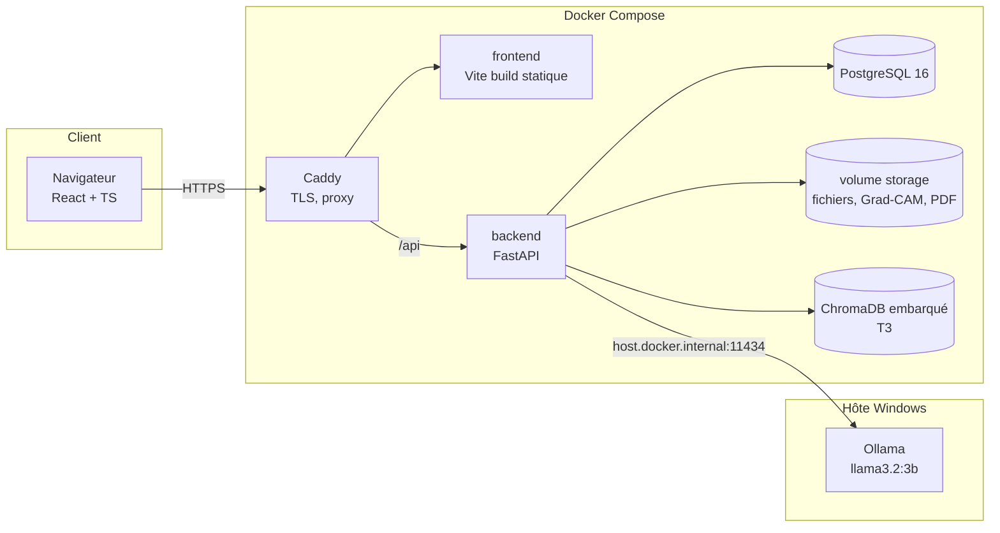
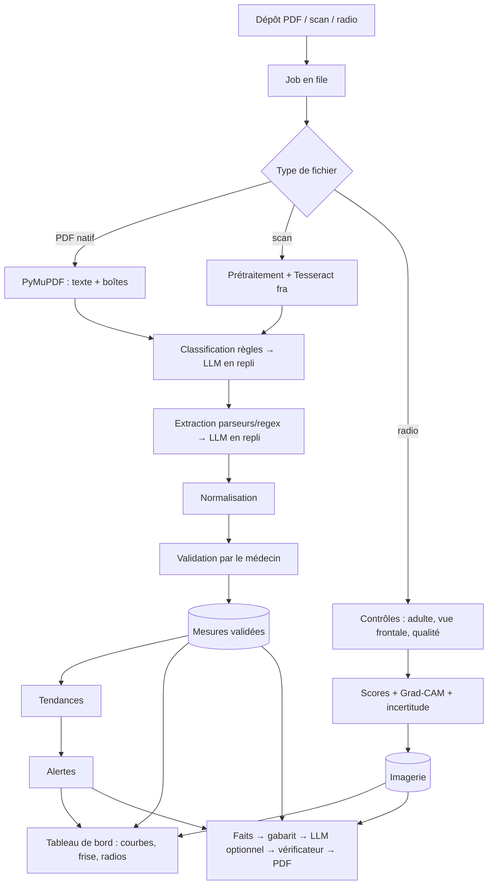

# Architecture

> Détail des choix : `docs/PLAN.md` §7 et `docs/DECISIONS.md`. Diagrammes UML : `docs/uml/` (PlantUML, rendu via l'extension VS Code PlantUML ou https://www.plantuml.com).

## 1. Composants

## 2. Découpage du backend

| Couche | Rôle |
|---|---|
| `api/` | Routes REST, contrôle d'accès (`current_user`, `require_role`, `get_patient_for_doctor`) |
| `schemas/` | Modèles Pydantic d'entrée/sortie |
| `services/ingestion` | Texte/OCR, classification, extraction, orchestration des jobs |
| `services/normalize` | Synonymes, unités, contexte, plausibilité, dédoublonnage |
| `services/trends`, `services/alerts` | Theil-Sen, qualification, moteur de règles YAML |
| `services/imaging` | Prétraitement, inférence TorchXRayVision, Grad-CAM, augmentation à l'inférence |
| `services/summary` | Faits, gabarit, LLM, vérificateur, PDF |
| `services/llm` | Client Ollama unique (timeouts, schéma JSON, journalisation) |
| `services/rag` | Index, recherche, réponse citée (T3) |
| `core/` | Configuration, sécurité (JWT, bcrypt), journalisation, audit |
| `db/` | Modèles SQLAlchemy, session, migrations Alembic |

## 3. Flux de données principal

## 4. Principes transverses

- **Isolation** : toute requête patient passe par `get_patient_for_doctor` ; l'admin n'a pas accès aux données patient.
- **Traçabilité** : chaque sortie IA stocke la version du modèle et du référentiel ; chaque action est journalisée.
- **Asynchrone simple** : BackgroundTasks FastAPI + table `jobs` ; pas de Celery ni de Redis.
- **LLM local** : un seul client `services/llm`, aucun autre chemin réseau sortant.
